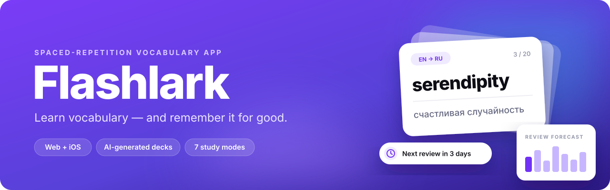
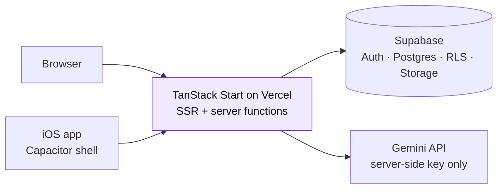

<div align="center">



<br>

<a href="https://word-ace-deck.vercel.app"></a>

<br><br>


<p>
  <a href="#features">Features</a> ·
  <a href="#study-modes">Study modes</a> ·
  <a href="#architecture">Architecture</a> ·
  <a href="#security-and-data-integrity">Security</a> ·
  <a href="#getting-started">Getting started</a>
</p>

</div>

## About

**Flashlark** is a calm, ad-free flashcard app for learning vocabulary. Spaced repetition brings each word back just before you would forget it, so it settles into long-term memory instead of fading away.

Build decks by hand, import them from CSV, or let AI create one from a topic, an article link or a photo of a word list. Then study in seven modes, keep a daily streak and share your best decks with the community. Flashlark runs on the web and as an iOS app.

## Features

<table>
<tbody>
<tr valign="top">
<td width="50%">

### Spaced repetition
Each deck has a recall queue with words ready for review, upcoming reviews, retention and mastered words. Reminders tell you when a deck is due: not too early, not too late.

</td>
<td width="50%">

### AI deck builder
Create a deck from a topic and level, an article URL, pasted text or a photo of a word list. AI can also add translations, suggest memory associations and write a short story that uses every word in your deck.

</td>
</tr>
</tbody>
<tbody>
<tr valign="top">
<td>

### Community library
Publish decks and collections, browse creator pages and add friends. Every public deck can be reported, every user can be blocked, and moderators have a review queue.

</td>
<td>

### Progress you can see
Daily streaks that respect your time zone, a review forecast for the days ahead and per-deck statistics.

</td>
</tr>
</tbody>
<tbody>
<tr valign="top">
<td>

### 10 learning languages
English, Spanish, French, German, Chinese (Mandarin), Japanese, Korean, Russian, Portuguese and Italian.

</td>
<td>

### Web and iOS
The iOS app adds daily reminder notifications, haptics, native sharing and an offline screen. Decks can be exported to and imported from CSV, and CSV import works offline.

</td>
</tr>
</tbody>
</table>

## Study modes

| Mode | How it works |
| --- | --- |
| **Flashcards** | Classic flip cards |
| **Delayed recall** | Spaced-repetition session for the words that are due |
| **Typed translation** | Type the answer; fuzzy matching forgives small typos |
| **Both directions** | Word → translation and back, weakest side first |
| **Multiple choice** | Pick the correct translation |
| **Speed challenge** | 30, 60 or 120 seconds, with combos and personal records |
| **Associations** | AI-suggested memory hooks for hard words |

## Architecture



The iOS app is a Capacitor shell around the production site. Server functions and authentication stay on Vercel, so every web release reaches iPhone users immediately. A new native build is needed only when the native layer changes.

## Security and data integrity

- **Every AI call is authenticated and metered.** Per-endpoint rate limits, per-user and global daily budgets, concurrency slots and idempotency keys are enforced atomically in PostgreSQL. A kill switch can turn AI off without a deploy.
- **AI only with consent.** Users are asked before their content is sent to the model.
- **Safe imports.** Article links go through an SSRF-safe fetcher. Images must be PNG, JPEG or WebP, are checked by their magic bytes and are limited to 2.5 MB.
- **Server-verified progress.** Study answers are checked on the server, so streaks and statistics cannot be forged from the browser.
- **Private profiles.** Email addresses are never stored in public profile data.
- **Atomic writes.** Creating a deck or replacing a collection's decks either fully succeeds or changes nothing.

### Quality checks

| Check | Details |
| --- | --- |
| Unit tests | 104 tests on Node's built-in test runner |
| Database tests | 6 SQL suites run with `supabase test db` |
| Static checks | Scripts guarding AI security, profile privacy, study-data integrity and atomic writes |
| CI | 5 GitHub Actions workflows: lint, type check, tests and build on every pull request, plus dedicated security and integrity checks |

Design notes for each area are in [`docs/`](docs).

## Tech stack

| Layer | Tools |
| --- | --- |
| App | TanStack Start, TanStack Router, TanStack Query, React 19, TypeScript, Vite |
| UI | Tailwind CSS 4, Radix UI, Recharts, Lucide icons |
| Backend | Supabase Auth, PostgreSQL, Row Level Security, Storage, 38 SQL migrations |
| AI | Google Gemini API, called only from server functions |
| Mobile | Capacitor 8 for iOS: notifications, haptics, share, splash screen |
| Hosting | Vercel (Nitro output) |

## Getting started

**Requirements:** Node.js 22+, npm and a Supabase project. A Gemini API key is needed for AI features.

```bash
npm install
cp .env.example .env   # fill in your Supabase and Gemini values
npm run dev
```

Apply the database migrations to your Supabase project:

```bash
supabase link --project-ref YOUR_PROJECT_REF
supabase db push
```

| Command | What it does |
| --- | --- |
| `npm run dev` | Dev server |
| `npm run build` | Production build for Vercel |
| `npm run lint` · `npm run typecheck` | ESLint and TypeScript |
| `npm test` | Unit tests |
| `npm run ios:sync` · `npm run ios:open` | Sync and open the iOS project in Xcode |

> **Keys:** `GEMINI_API_KEY` and `SUPABASE_SERVICE_ROLE_KEY` are server-only. Never put them in a `VITE_*` variable, because those are visible in the browser.

## Project structure

```text
src/
├── routes/        File-based routes: dashboard, decks, study modes, community, profile
├── components/    App components and the UI kit
├── lib/           Server functions, AI client and security, study logic, CSV, i18n
└── integrations/  Supabase client and generated types
supabase/
├── migrations/    Schema, RLS policies, RPCs
└── tests/         SQL test suites
ios/               Native iOS project (Capacitor)
ios-shell/         Offline fallback page for the iOS app
scripts/           Static security and integrity checks
docs/              Design and security notes
```

---

<div align="center">
<sub>Built by <a href="https://github.com/YelzhasTem">Yelzhas</a>.</sub>
</div>
